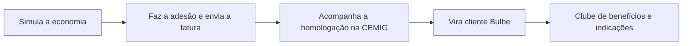
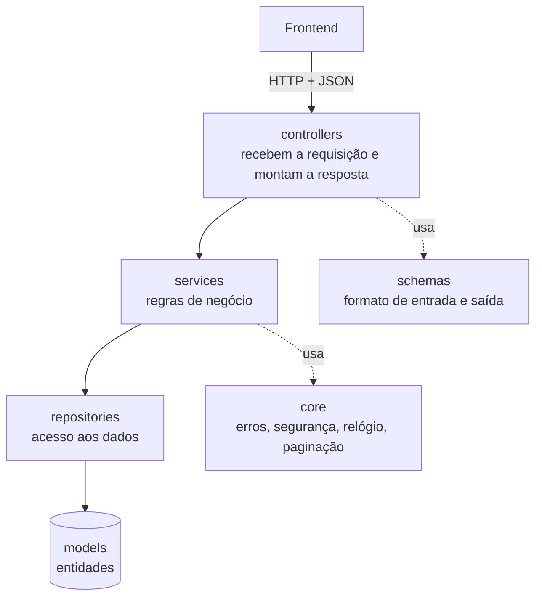

<div align="center">

# ⚡ Bulbe Evolution — Backend

**API da jornada do cliente da Bulbe Energia: simular a economia na conta de luz, acompanhar a homologação na CEMIG e aproveitar o clube de benefícios.**


[Rodar o projeto](#-rodar-o-projeto) · [Testar a API](#-testar-a-api) · [Endpoints](#-endpoints) · [Estrutura](#-estrutura-de-pastas)

</div>

---

## 📌 Sobre o projeto

| | |
|---|---|
| **Empresa parceira** | Bulbe Energia |
| **Problema** | A homologação junto à CEMIG leva de 90 a 120 dias. Esse "vácuo operacional" gera desconfiança, cancelamentos precoces e inadimplência no primeiro boleto. |
| **O que o backend entrega** | Simulação de economia sem login, acompanhamento do pedido de homologação etapa por etapa, clube de benefícios com trilhas e resgates para engajar o cliente antes da primeira fatura, e textos de ajuda do mascote **Bulbinho**. |
| **Continuidade** | Este repositório é o backend do Projeto Ciência de Dados II. Ele serve o frontend entregue no Projeto Ciência de Dados I: [bulbe-squad-matrix](https://github.com/fernandadutra/bulbe-squad-matrix). |

### Jornada do cliente



## 👥 Equipe — Squad Matrix

| Nome | Frente principal |
|---|---|
| Augusto Gama Dias Lobo-Martins | — |
| Felipe Lara Alves Braga | API, banco de dados, autenticação e testes |
| Fernanda Vaccillotto Pimenta Dutra | Indique e ganhe, notificações e boas-vindas |
| Leandro Dias de Oliveira | Login e sessões, faturas e consumo |
| Mariana Resende Maia | Documentação: README e validação do desconto |
| Rafael Bentes Fonseca | Adesão com envio de fatura |

## 🧰 Tecnologias

| | |
|---|---|
| **Linguagem** | Python 3.12 |
| **Framework** | FastAPI + Uvicorn |
| **Autenticação** | Token JWT (PyJWT) |
| **Documentação da API** | OpenAPI 3 (Swagger UI automática em `/docs`) |
| **Testes** | Pytest + HTTPX |
| **Dados** | Em memória, com clientes e benefícios de exemplo (ver [Banco de dados](#-banco-de-dados)) |

## 🏗️ Arquitetura

O código segue camadas. Cada uma só conversa com a de baixo.



---

## 🚀 Rodar o projeto

**Você precisa de:** Python 3.12 e Git.

### 1. Baixar o código

```bash
git clone https://github.com/fernandadutra/backendBulbe_Matrix.git
cd backendBulbe_Matrix
```

> 🔀 Enquanto o Pull Request do Bloco 1 não for aprovado, o código completo está na branch `feature/endpoints-bloco1-api`.
> Troque para ela com `git checkout feature/endpoints-bloco1-api`.

### 2. Criar o ambiente e instalar as dependências

<details open>
<summary><b>Windows (PowerShell)</b></summary>

```powershell
python -m venv .venv
.venv\Scripts\python -m pip install -r requirements.txt
```

</details>

<details>
<summary><b>macOS / Linux</b></summary>

```bash
python3 -m venv .venv
.venv/bin/python -m pip install -r requirements.txt
```

</details>

### 3. Iniciar o servidor

```bash
.venv/Scripts/python -m uvicorn app.main:app --reload     # Windows
.venv/bin/python -m uvicorn app.main:app --reload         # macOS / Linux
```

A API sobe em **http://127.0.0.1:8000**. Para conferir, abra:

| Endereço | O que mostra |
|---|---|
| http://127.0.0.1:8000/ | Mensagem `API Bulbe funcionando com sucesso!` |
| http://127.0.0.1:8000/docs | Swagger UI, onde dá para testar cada rota pelo navegador |
| http://127.0.0.1:8000/openapi.json | Contrato da API em JSON |

### Variáveis de ambiente (opcionais em desenvolvimento)

| Variável | Para que serve | Padrão |
|---|---|---|
| `BULBE_JWT_SEGREDO` | Segredo que assina os tokens. **Obrigatória em produção.** | Segredo de desenvolvimento (o servidor avisa no terminal) |
| `BULBE_LIMITE_SIMULACOES_POR_MINUTO` | Limite de simulações por minuto | `30` |

---

## 🧪 Testar a API

### Pelo navegador (mais fácil)

1. Abra http://127.0.0.1:8000/docs.
2. Escolha `POST /api/v1/simulacoes` e clique em **Try it out**.
3. Use o corpo `{"valor_fatura_centavos": 35000}` e clique em **Execute**.

### Pelo terminal

**Simulação (pública, não precisa de token):**

```powershell
# PowerShell
Invoke-RestMethod -Method Post -Uri http://127.0.0.1:8000/api/v1/simulacoes `
  -ContentType 'application/json' -Body '{"valor_fatura_centavos": 35000}'
```

```bash
# bash
curl -X POST http://127.0.0.1:8000/api/v1/simulacoes \
  -H "Content-Type: application/json" -d '{"valor_fatura_centavos": 35000}'
```

Resposta esperada (resumo): `economia_mensal_centavos: 5250`, `valor_com_bulbe_centavos: 29750`, `economia_anual_centavos: 63000`.

**Rotas que exigem login:** enquanto `POST /sessoes` não existir, gere um token de desenvolvimento.

```bash
.venv/Scripts/python gerar_token_dev.py                 # cliente Ana Souza (cli_3b9e1f42)
.venv/Scripts/python gerar_token_dev.py cli_8d21c7a0    # cliente Bruno Lima
```

```powershell
$token = (.venv\Scripts\python gerar_token_dev.py).Trim()
Invoke-RestMethod -Uri http://127.0.0.1:8000/api/v1/pedidos -Headers @{ Authorization = "Bearer $token" }
```

> No Swagger UI, clique em **Authorize** (cadeado) e cole o token.

### Rodar os testes automáticos

```bash
.venv/Scripts/python -m pytest -q          # Windows
.venv/bin/python -m pytest -q              # macOS / Linux
```

Resultado esperado: **105 testes passando** (conferido em 25/10/2026).

| Arquivo | O que cobre |
|---|---|
| `tests/test_simulacoes.py` | Conta da economia, limites de valor, distribuidora, histórico |
| `tests/test_pedidos.py` | Lista de pedidos e status da homologação |
| `tests/test_beneficios.py` | Benefícios, trilhas e resgates |
| `tests/test_ajuda.py` | Dicas do Bulbinho |
| `tests/test_geral.py` | Erros padrão e comportamento geral |

---

## 🔌 Endpoints

**URL base:** `/api/v1` · **Formato:** JSON · **Valores em dinheiro:** sempre em **centavos** (`35000` = R$ 350,00) · **Autenticação:** `Authorization: Bearer <token>`

### ✅ Bloco 1 — implementados (Sprint 1)

| Método | Rota | O que faz | Login |
|---|---|---|:-:|
| `POST` | `/simulacoes` | Calcula a economia estimada com memória de cálculo | Não |
| `GET` | `/simulacoes` | Histórico de simulações do cliente | Sim |
| `GET` | `/simulacoes/{id}` | Uma simulação com o cálculo completo | Sim |
| `GET` | `/pedidos` | Pedidos de homologação do cliente | Sim |
| `GET` | `/pedidos/{id}/status` | Etapa atual, etapas concluídas e próxima atualização | Sim |
| `GET` | `/beneficios` | Benefícios ativos e parceiros | Sim |
| `GET` | `/beneficios/{id}` | Um benefício com regras de uso | Sim |
| `GET` | `/trilhas` | Trilhas do clube e estado de desbloqueio | Sim |
| `POST` | `/beneficios/{id}/resgates` | Resgata um benefício | Sim |
| `GET` | `/resgates` | Resgates já feitos | Sim |
| `GET` | `/ajuda/dicas` | Textos de ajuda do Bulbinho por tela | Não |

### 🛠️ Bloco 2 — planejados (contrato pronto, código em andamento)

| Frente | Rotas | Prioridade | Responsável |
|---|---|---|---|
| Login e sessões | `POST /sessoes`, `POST /sessoes/renovacao`, `DELETE /sessoes`, `GET /perfil` | Alta (bloqueante) | Leandro |
| Adesão com envio de fatura | `POST /interessados`, `POST /adesoes`, `PATCH /adesoes/{id}`, `POST /adesoes/{id}/anexos`, `/aceites`, `/submissao` | Alta | Rafael |
| Faturas e consumo | `GET /faturas`, `GET /faturas/{id}`, `GET /consumo` | Média | Leandro |
| Indique e ganhe | `GET /indicacoes`, `POST /indicacoes` | Média | Fernanda |
| Notificações | `GET /notificacoes`, `PATCH /notificacoes/{id}` | Baixa | Fernanda |
| Boas-vindas | `GET /conteudos/boas-vindas` | Baixa | Fernanda |

O contrato completo, com exemplos de requisição e resposta, está em [`docs/api/lista-endpoints.md`](docs/api/lista-endpoints.md) e [`docs/api/openapi.yaml`](docs/api/openapi.yaml).

### Erros

Todo erro vem no mesmo formato, para o frontend tratar em um lugar só:

```json
{
  "erro": {
    "codigo": "CONSUMO_FORA_DA_FAIXA",
    "mensagem": "O valor da fatura deve estar entre R$ 50,00 e R$ 5.000,00.",
    "detalhes": [{ "campo": "valor_fatura_centavos", "problema": "abaixo do mínimo aceito" }]
  }
}
```

---

## 🗄️ Banco de dados

Hoje os dados ficam **em memória**: clientes, pedidos, benefícios e dicas são carregados de `app/repositories/dados_iniciais.py` quando o servidor inicia. Ao reiniciar, tudo volta ao estado inicial e o que foi criado se perde (simulações e resgates, por exemplo).

A troca por um banco de verdade está planejada. Como os dados são acessados só pela camada `repositories`, a mudança fica concentrada ali. O modelo e o dicionário de dados ainda **não foram escritos**: o espaço reservado para eles é `docs/banco-de-dados`.

## 📁 Estrutura de pastas

```
app/
├── main.py              cria a API e registra as rotas
├── controllers/         recebem a requisição e devolvem a resposta
├── services/            regras de negócio (ex.: simulacao_service.py)
├── repositories/        acesso aos dados (hoje em memória)
├── models/              entidades do domínio
├── schemas/             formato de entrada e saída de cada rota
└── core/                erros, segurança (JWT), relógio, paginação, limite de requisições
tests/                   testes automáticos (105)
requirements.txt         dependências do projeto
pytest.ini               configuração dos testes
docs/
├── requisitos.md        requisitos funcionais e não funcionais
├── sprints/             user stories e documentos de cada sprint
├── api/                 lista de endpoints e openapi.yaml
├── diagramas/           casos de uso, atividades e sequências (PlantUML)
├── arquitetura          (reservado: diagrama de camadas, ainda vazio)
└── banco-de-dados       (reservado: modelo e dicionário de dados, ainda vazio)
gerar_token_dev.py       gera token de teste para as rotas com login
gerar_openapi.py         exporta o contrato OpenAPI
```

## 📚 Documentação do projeto

| Documento | Para quê |
|---|---|
| [`docs/requisitos.md`](docs/requisitos.md) | Requisitos RF-01 a RF-04 e RNF-01 a RNF-03 |
| [`docs/sprints/user-stories.md`](docs/sprints/user-stories.md) | Histórias de usuário |
| [`docs/api/lista-endpoints.md`](docs/api/lista-endpoints.md) | Contrato de cada rota |
| [`docs/apresentacao-sprint1.html`](docs/apresentacao-sprint1.html) | Apresentação da Sprint 1 |
| [`docs/apresentacao-backend.html`](docs/apresentacao-backend.html) | Apresentação do backend |

## 🔀 Convenção de commits e branches

- **Branches:** `main` (estável) e `feature/nome-da-funcionalidade`
- **Commits** no padrão Conventional Commits: `feat:`, `fix:`, `docs:`, `test:`, `refactor:`, `chore:`
- **Pull Requests** revisados por pelo menos uma pessoa do grupo antes do merge

## 🎓 Contexto acadêmico

Projeto desenvolvido para a disciplina **Projeto Ciência de Dados II**, Ibmec, 2º semestre de 2026, sob orientação do professor Cristiano de Macedo Neto, M.Sc.

**Extensão universitária:** a ser preenchida na Aula 32.
